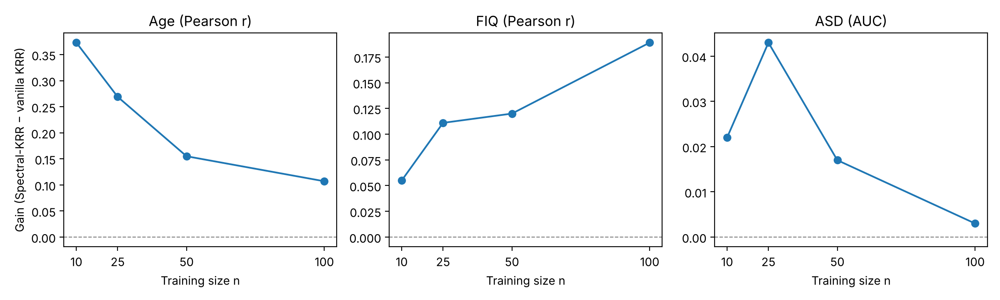

# Spectral-KRR: Recovering Cognition Signal from fMRI Connectomes in the Small-Sample Regime


A small-sample benchmark for phenotype prediction from resting-state fMRI connectomes (ABIDE-I, CC200).
Spectral filtering of the functional connectivity matrix lets a ridge model extract cognition signal
(Full-Scale IQ) where vanilla kernel ridge regression has near-zero skill, and improves age and ASD
prediction as well.

## Key Findings

Setting with the largest gain for each target (mean over 5 seeds, site NYU):

| Target | Metric | Vanilla KRR | **Spectral-KRR** | Gain |
|:---|:---|:---:|:---:|:---:|
| Age (n = 10) | Pearson r | 0.151 | **0.524** | +0.373 |
| FIQ (n = 100) | Pearson r | 0.047 | **0.236** | +0.189 |
| ASD (n = 25) | AUC | 0.595 | **0.638** | +0.043 |

- Spectral-KRR has a higher mean score than vanilla KRR in all 18 settings (3 targets × 6 sample sizes).
- The absolute gain is largest for age at very small n; the relative gain is largest for FIQ, where
  vanilla KRR is near chance.
- Diffusion-based augmentation and a latent-space ridge baseline did not help (see below).



## FIQ Recovery

FIQ is the hardest phenotype in the benchmark. Vanilla KRR reaches r = 0.047 at n = 100.

| n | Vanilla KRR | **Spectral-KRR** | Gain |
|:---:|:---:|:---:|:---:|
| 10 | 0.007 | **0.062** | +0.055 |
| 25 | 0.003 | **0.114** | +0.111 |
| 50 | −0.006 | **0.114** | +0.120 |
| 100 | 0.047 | **0.236** | +0.189 |

At n ≤ 50 the correlations are small (r ≈ 0.06–0.11) and are best read as suggestive; the clearest
signal appears at n = 100.

## Full Benchmark

Tables show n ∈ {10, 25, 50, 100}; n = 15 and 75 are in `results/`.

**Age (Pearson r, NYU)**

| n | Vanilla KRR | Spectral-KRR | Diffusion Aug | Latent Ridge |
|:---:|:---:|:---:|:---:|:---:|
| 10 | 0.151 | **0.524** | −0.023 | −0.023 |
| 25 | 0.368 | **0.637** | −0.033 | 0.057 |
| 50 | 0.565 | **0.720** | −0.051 | 0.036 |
| 100 | 0.658 | **0.765** | −0.124 | 0.251 |

**FIQ (Pearson r)**

| n | Vanilla KRR | Spectral-KRR | Diffusion Aug | Latent Ridge |
|:---:|:---:|:---:|:---:|:---:|
| 25 | 0.003 | **0.114** | 0.017 | −0.015 |
| 50 | −0.006 | **0.114** | 0.007 | 0.028 |
| 100 | 0.047 | **0.236** | −0.004 | −0.032 |

**ASD (AUC)**

| n | Vanilla KRR | Spectral-KRR |
|:---:|:---:|:---:|
| 10 | 0.533 | **0.555** |
| 25 | 0.595 | **0.638** |
| 50 | 0.679 | **0.696** |
| 100 | 0.697 | **0.700** |

## Method

Given a functional connectivity matrix FC ∈ ℝ^(200×200), eigenvalues are power-scaled:

```
FC^α = V · diag(λ^α) · Vᵀ,    α = 0.3
```

The upper triangle of FC^α (19,900 edges) is the feature vector. The filter and α = 0.3 follow
[Marraffini et al., 2026](https://arxiv.org/abs/2609.37642); this repository studies it as a
small-sample benchmark across phenotypes.

```
connectome (200×200) → FC^α filter (α = 0.3) → edge features → RidgeCV → phenotype
```

"KRR" here is kernel ridge regression with a linear kernel on edge features (ridge regression).
For ASD, the same features go into an L2 logistic regression and the score is AUC.

**Other components evaluated (not used as primary methods)**

| Component | Role | Outcome |
|:---|:---|:---|
| MAE pretraining (42M params) | Neural baseline | Below KRR at small n |
| Latent DDPM (continuous age conditioning) | Generative augmentation | Lowers MAE but collapses r |
| Adaptive α (nested CV) | Hyperparameter tuning | No gain over fixed α = 0.3 |

The diffusion result is reported as a diagnostic: augmentation acts as a mean-regularizer rather than
a signal extractor. The MAE and DDPM training code is not part of this repository; the latent baselines
in `src/evaluate.py` read precomputed latents (`Z_all.npy`, `synthetic_latents.npz`) and are skipped
when those files are not provided.

## Quick Start

```bash
git clone https://github.com/souvikpramanik-medimg/Spectral-KRR-fMRI.git
cd Spectral-KRR-fMRI
pip install -r requirements.txt

# expects data/abide_cc200_asd.npz (see the note below)
python src/evaluate.py --config configs/base.yaml     # results -> results/summary_*.csv
python src/plot.py                                    # results/figure_gain_vs_n.png
```

> **Data:** `abide_cc200_asd.npz` is not included in this repository. ABIDE-I can be
> obtained from the [ABIDE website](http://fcon_1000.projects.nitrc.org/indi/abide/).
> The script expects an `.npz` file with these arrays (871 subjects, CC200 atlas):
> `connectomes` (871 × 19900, upper-triangle FC edges), `site`, `age`, `fiq`, `asd`
> (missing values as NaN; `asd` coded 0 = control, 1 = ASD).

| Stage | Time (T4) |
|:---|:---:|
| Eigendecomposition (871 × 200×200) | 7 s |
| Spectral features (5 α values) | 3 s |
| Full grid (450 runs) | ~11 min |

## Repository Structure

```
spectral-krr/
├── configs/base.yaml        # all hyperparameters
├── src/
│   ├── data.py              # npz loader, train/test split
│   ├── spectral.py          # FC^α filtering (core method)
│   ├── evaluate.py          # grid search and metrics
│   ├── utils.py             # ridge / logistic fits, metrics, nested-CV α selection
│   └── plot.py              # gain-vs-n figure from results/summary_*.csv
├── results/                 # summary_{age,fiq,asd}.csv, figure_gain_vs_n.png
├── notebooks/quickstart.ipynb
└── requirements.txt
```

## Reproducibility

| | |
|:---|:---|
| Dataset | ABIDE-I, CC200 atlas, 871 quality-controlled subjects |
| Evaluation site | NYU (n = 172); n training subjects sampled from NYU, remaining NYU subjects used for testing |
| Sample sizes | n ∈ {10, 15, 25, 50, 75, 100} |
| Seeds | 5 per configuration |
| Total runs | 450 (3 targets × 6 n × 5 seeds × 5 methods) |

```yaml
# configs/base.yaml
data:
  path: data/abide_cc200_asd.npz
  site: NYU
spectral:
  alpha: 0.3
  atlas_size: 200
model:
  ridge_alphas: [0.01, 0.1, 1.0, 10.0, 100.0, 1000.0]
eval:
  n_values: [10, 15, 25, 50, 75, 100]
  seeds: [0, 1, 2, 3, 4]
  targets: [age, fiq, asd]
```

## Scope and Future Work

This benchmark uses one site (NYU), one atlas (CC200) and five seeds per setting.

**Planned next steps**
- Leave-one-site-out evaluation and confidence intervals across seeds.
- Other atlases and datasets (for example HCP) and further cognitive phenotypes.
- Per-setting significance tests for the small-n FIQ results.
- Understanding why spectral filtering helps, for example which eigenmodes carry the cognition signal.

## Acknowledgements

Builds on the spectral filter from Marraffini et al., "Flattening the Connectome Spectrum"
(arXiv:2609.37642, 2026). Data: [ABIDE-I](http://fcon_1000.projects.nitrc.org/indi/abide/).

## License

MIT. See `LICENSE`.
